 

I'm a final-year B.Tech student in Artificial Intelligence and Data Science (Class of 2027), and I build LLM applications that go beyond a demo: retrieval that is evaluated, agents that are guarded, and pipelines that return structured, validated output.

My focus is agentic AI and retrieval-augmented systems, especially natural-language interfaces to data. These are agents that plan, call tools, remember context, and ask for human approval before doing anything risky.

National finalist at the Cognizant TechnoVerse Hackathon 2026, and Microsoft-certified in Azure AI app and agent development and in Fabric analytics.

 

 

- **Problem:** business users depend on analysts and SQL to answer simple data questions.
- **Built:** upload a CSV, ask in plain English, and get the generated SQL, a written summary and an interactive chart.
- **Architecture:** `Guardrails` → `Router (SQL / RAG / hybrid)` → `Memory` → `Schema-aware SQL` → `SQL firewall + human approval` → `DuckDB on S3` → `Summary` → `Chart`. It is a 12-node LangGraph supervisor, with 8 tools exposed over MCP behind a FastAPI gateway and a documented 31-test suite.
- **Repository:** [amjathhussain31/Data-Agent](https://github.com/amjathhussain31/Data-Agent)

- **Problem:** generated SQL is only as good as the model's grasp of the schema and the business vocabulary.
- **Built:** a conversational analytics agent for SQLite, PostgreSQL and MySQL that answers, explains the result and draws the chart.
- **Architecture:** `Question` → `LangChain ReAct agent` → tools for `schema lookup`, `glossary RAG (FAISS)`, `SQL execution`, `insights` and `charts` → `Answer`. Short- and long-term memory, input and output guardrails, and Langfuse tracing sit around the loop.
- **Repository:** [amjathhussain31/local-sql-agent](https://github.com/amjathhussain31/local-sql-agent)

- **Problem:** RFP packages mix long PDFs, portal pages and addenda, and a later addendum can silently change a deadline or requirement.
- **Built:** a pipeline that turns an RFP package into validated JSON with 20 fields, such as due date, bid bond and payment terms.
- **Architecture:** `PDF / HTML parsing` → `cleaning` → `metadata-tagged chunks` → `FAISS retrieval per field` → `addendum override` → `LLM extraction` → `Pydantic validation`. Fields the documents do not support come back as `null`, and 12 tests are documented.
- **Repository:** [amjathhussain31/RFP-Intelligence-Extractor](https://github.com/amjathhussain31/RFP-Intelligence-Extractor)

- **Problem:** language models hallucinate on private documents, and "it seems to work" is not a quality bar.
- **Built:** a PDF question-answering chatbot with session memory and switchable open models (Mistral 7B, LLaMA 2), evaluated with RAGAS.
- **Architecture:** `Loader` → `Splitter` → `Embeddings` → `FAISS retriever` → `Chain + memory` → `RAGAS evaluator`. In the sample run in the README, faithfulness and answer relevancy scored 1.00 and context recall 0.60, and the repository lists the retrieval limits it found.
- **Repository:** [amjathhussain31/Week-2-RAG-Chatbot](https://github.com/amjathhussain31/Week-2-RAG-Chatbot)

- **Problem:** an agent that can call tools also needs boundaries, memory and a way to show its reasoning.
- **Built:** a fully local conversational agent that blocks out-of-domain or unsafe requests, remembers users across sessions, and shows a live tool trace.
- **Architecture:** `Input validation` → `Guardrail rails` → `Graph routing` → `ReAct agent` → `Optional human approval` → `Output formatter`. Memory has two layers, the last six interactions plus a long-term JSON store, and the agent has six tools.
- **Repository:** [amjathhussain31/Week-3-Domain-Aware-Agent](https://github.com/amjathhussain31/Week-3-Domain-Aware-Agent)

- **Problem:** answering questions from a PDF with answers grounded in its content rather than the model's memory.
- **Built:** a notebook-based RAG application with a persistent vector store.
- **Architecture:** `PDF loading` → `Chunking` → `Sentence-transformer embeddings` → `ChromaDB` → `Top-chunk retrieval` → `Local LLM answer`.
- **Repository:** [amjathhussain31/Week-1-Presidio-Summer-Internship-26](https://github.com/amjathhussain31/Week-1-Presidio-Summer-Internship-26)

 

| Area | What I work with |
|---|---|
|  **AI Engineering** | Evaluation-driven development (RAGAS), input and output guardrails, tracing and observability (Langfuse, CloudWatch), structured outputs validated with Pydantic |
|  **Agentic AI Systems** | LangGraph supervisor workflows, ReAct agents, tool calling, Model Context Protocol servers, short- and long-term memory, human-in-the-loop approval |
|  **RAG & Knowledge Retrieval** | Chunking strategies, sentence-transformer embeddings, FAISS and ChromaDB, query routing across SQL, documents and hybrid, per-field context budgeting |
|  **LLM Application Development** | AWS Bedrock, Gemini, Groq and local models through Ollama, LangChain, natural language to SQL, Streamlit interfaces |
|  **Backend Engineering** | FastAPI and REST APIs, PostgreSQL, MySQL, DynamoDB, DuckDB, testing with pytest |
|  **Cloud Technologies** | AWS (Bedrock, S3, DynamoDB, CloudWatch, EC2), Microsoft Azure, IBM Cloud |

 

**Programming** &nbsp; `Python` `Java` `C++` `SQL`
**AI / ML** &nbsp; `Machine Learning` `Deep Learning` `NLP` `Generative AI`
**LLM engineering** &nbsp; `LangChain` `LangGraph` `RAG` `Agentic AI` `MCP` `RAGAS` `Langfuse`
**Backend** &nbsp; `FastAPI` `REST APIs`
**Databases** &nbsp; `PostgreSQL` `MySQL` `DynamoDB` &nbsp;·&nbsp; **Vector** &nbsp; `FAISS` `ChromaDB`
**Cloud** &nbsp; `AWS` `Microsoft Azure` `IBM Cloud`
**Data and analytics** &nbsp; `Pandas` `NumPy` `Matplotlib` `Power BI`
**Tools** &nbsp; `Git` `GitHub` `VS Code` `Postman` `Jupyter`

 

Presidio weekly deliverables and hands-on practice

| Week | Work | Repository |
|---|---|---|
| 1 - GenAI Foundations | RAG practice | [Rag-Practice](https://github.com/amjathhussain31/Rag-Practice) |
| 1 - GenAI Foundations | Deliverable: Simple RAG application (PDF question answering) | [Week-1-Presidio-Summer-Internship-26](https://github.com/amjathhussain31/Week-1-Presidio-Summer-Internship-26) |
| 2 - Prompting and LangChain | LangChain sequential practice | [LangChain-Practice](https://github.com/amjathhussain31/LangChain-Practice) |
| 2 - Prompting and LangChain | Multimodal chatbot (text and images) | [Multimodal-Chatbot-Practice](https://github.com/amjathhussain31/Multimodal-Chatbot-Practice) |
| 2 - Prompting and LangChain | Streamlit chatbot interface | [Streamlit-Practice](https://github.com/amjathhussain31/Streamlit-Practice) |
| 2 - Prompting and LangChain | Mini task: RAG chatbot with FAISS and RAGAS | [Week-2-RAG-Chatbot](https://github.com/amjathhussain31/Week-2-RAG-Chatbot) |
| 3 - Agentic AI | Agent practice: reasoning, tools and memory | [agent-practice](https://github.com/amjathhussain31/agent-practice) |
| 3 - Agentic AI | Mini task: domain-aware ReAct agent | [Week-3-Domain-Aware-Agent](https://github.com/amjathhussain31/Week-3-Domain-Aware-Agent) |

 

  
  
  

