## About

I'm a final-year B.Tech student in Artificial Intelligence and Data Science (Class of 2027), and I build LLM applications that go beyond a demo: retrieval that is evaluated, agents that are guarded, and pipelines that return structured, validated output.

My current focus is agentic AI and retrieval-augmented systems, especially natural-language interfaces to data: agents that plan, call tools, remember context, and ask for human approval before doing anything risky.

National finalist at the Cognizant TechnoVerse Hackathon 2026. Microsoft-certified in Azure AI app and agent development, and in Fabric analytics.

## What I Build

- **Agentic AI systems** - supervisor and ReAct agents with tool use, memory, guardrails and human-in-the-loop approval.
- **RAG applications** - document question answering with embeddings, vector search and measured answer quality.
- **LLM-powered solutions** - natural language to SQL, structured extraction and conversational analytics.
- **Intelligent automation** - turning long, messy documents and data requests into validated, usable output.

## Featured Projects

### DataMind Agent
*Cognizant TechnoVerse Hackathon 2026 - National Finalist* · [Repository](https://github.com/amjathhussain31/Data-Agent)

| | |
|---|---|
| **Problem** | Business users depend on analysts and SQL to answer simple data questions. |
| **Built** | A conversational analytics platform: upload a CSV, ask in plain English, and get the generated SQL, a written summary and an interactive chart. |
| **Approach** | A 12-node LangGraph supervisor handles input guardrails, SQL / RAG / hybrid routing, memory recall, schema-aware SQL generation, a SQL firewall that requires human approval for writes, DuckDB execution over S3-backed data, summarising and charting. Tools are exposed through an MCP server (8 tools) behind a FastAPI gateway. The repository documents a 31-test suite. |
| **Stack** | `AWS Bedrock` `LangGraph` `MCP` `FastAPI` `DuckDB` `S3` `DynamoDB` `FAISS` `Plotly` `Streamlit` `CloudWatch` |

### SQL Agent
*Natural language to SQL with business context* · [Repository](https://github.com/amjathhussain31/local-sql-agent)

| | |
|---|---|
| **Problem** | Generated SQL is only as good as the model's understanding of the schema and the business vocabulary. |
| **Built** | A conversational analytics agent that answers questions over a database, explains the result and draws the chart. Designed for SQLite, PostgreSQL and MySQL. |
| **Approach** | A LangChain ReAct agent with tools for schema lookup, SQL execution, insight generation and charting. FAISS retrieval over a business glossary and schema documentation grounds the SQL. Short- and long-term memory, input and output guardrails, and Langfuse tracing cover follow-up questions, safety and observability. |
| **Stack** | `LangChain` `Gemini` `FAISS` `Sentence Transformers` `SQLAlchemy` `Streamlit` `Pandas` `Langfuse` |

### RFP Intelligence Extractor
*Structured extraction from procurement documents* · [Repository](https://github.com/amjathhussain31/RFP-Intelligence-Extractor)

| | |
|---|---|
| **Problem** | RFP packages mix long PDFs, portal pages and addenda, and a later addendum can silently change a deadline or requirement. |
| **Built** | A pipeline that turns an RFP package into validated JSON with 20 fields such as due date, bid bond, payment terms and product specifications. |
| **Approach** | PDF and HTML parsing, cleaning and metadata-tagged chunking, then FAISS retrieval per target field with a fair context budget under token limits. Addendum clauses override the original text, and fields that the documents do not support are returned as `null` instead of guessed. Pydantic enforces the schema, and the repository documents 12 tests. |
| **Stack** | `Python` `PyMuPDF` `BeautifulSoup4` `Sentence Transformers` `FAISS` `Groq` `Pydantic` `pytest` |

### RAG Chatbot with Evaluation
*Document Q&A that measures its own quality* · [Repository](https://github.com/amjathhussain31/Week-2-RAG-Chatbot)

| | |
|---|---|
| **Problem** | Language models hallucinate on private documents, and "it seems to work" is not a quality bar. |
| **Built** | A PDF question-answering chatbot with session memory and switchable open models (Mistral 7B, LLaMA 2), evaluated with RAGAS. |
| **Approach** | A modular pipeline of loader, splitter, embeddings, FAISS retriever, chain, memory and evaluator. In the sample run documented in the README, faithfulness and answer relevancy scored 1.00 and context recall 0.60, and the repository lists the retrieval limits it found (no reranking or hybrid search yet). |
| **Stack** | `Python` `FAISS` `Sentence Transformers` `Mistral` `LLaMA 2` `RAGAS` `Streamlit` |

### Domain-Aware ReAct Agent
*A local agent with guardrails, a workflow graph and memory* · [Repository](https://github.com/amjathhussain31/Week-3-Domain-Aware-Agent)

| | |
|---|---|
| **Problem** | An agent that can call tools also needs boundaries, memory and a way to show its reasoning. |
| **Built** | A conversational agent that runs fully locally, blocks out-of-domain or unsafe requests, remembers users across sessions, and shows a live tool trace in the UI. |
| **Approach** | Input validation, then a guardrail (rails) check, graph routing, a ReAct agent node, optional human approval and an output formatter. Dual-layer memory keeps the last six interactions in session and persists long-term memory to JSON. Six tools cover search, Wikipedia, weather, a calculator and memory. |
| **Stack** | `LangChain` `Mistral 7B` `Ollama` `Streamlit` `Python` |

### PDF Question Answering (RAG)
*End-to-end retrieval-augmented generation* · [Repository](https://github.com/amjathhussain31/Week-1-Presidio-Summer-Internship-26)

| | |
|---|---|
| **Problem** | Answering questions from a PDF with answers grounded in its content rather than the model's memory. |
| **Built** | A notebook-based RAG application with a persistent vector store. |
| **Approach** | PDF loading, text chunking, sentence-transformer embeddings stored in ChromaDB, top-chunk retrieval and answer generation with a local model. |
| **Stack** | `Python` `LangChain` `ChromaDB` `HuggingFace` `Ollama` `PyPDF` |

## Technical Expertise

| Area | What I work with |
|---|---|
| **AI Engineering** | Evaluation-driven development (RAGAS), input and output guardrails, tracing and observability (Langfuse, CloudWatch), structured outputs validated with Pydantic |
| **Agentic AI Systems** | LangGraph supervisor workflows, ReAct agents, tool calling, Model Context Protocol servers, short- and long-term memory, human-in-the-loop approval |
| **RAG & Knowledge Retrieval** | Chunking strategies, sentence-transformer embeddings, FAISS and ChromaDB, query routing across SQL, documents and hybrid, per-field context budgeting |
| **LLM Application Development** | AWS Bedrock, Gemini, Groq and local models through Ollama, LangChain, natural language to SQL, Streamlit interfaces |
| **Backend Engineering** | FastAPI and REST APIs, PostgreSQL, MySQL, DynamoDB, DuckDB, testing with pytest |
| **Cloud Technologies** | AWS (Bedrock, S3, DynamoDB, CloudWatch, EC2), Microsoft Azure, IBM Cloud |

## Technology Stack

  

  

**LLM engineering** &nbsp; `LangChain` `LangGraph` `RAG` `Agentic AI` `MCP` `RAGAS` `Langfuse`
**Vector search** &nbsp; `FAISS` `ChromaDB`
**Data and analytics** &nbsp; `SQL` `DynamoDB` `Matplotlib` `Power BI` `Jupyter`
**AI / ML** &nbsp; `Machine Learning` `Deep Learning` `NLP` `Generative AI`

## Achievements

**National Finalist - Cognizant TechnoVerse Hackathon 2026**
Reached the national finals with [DataMind Agent](https://github.com/amjathhussain31/Data-Agent), a conversational analytics platform built with Team Zyphron.

**Presidio GenAI Foundations Internship** - [Programme curriculum](https://app.notion.com/p/ajayr07/Presidio-Summer-Internship-26-31fbd94ad5e280b69acfc842ce0bb018)
A structured programme covering GenAI foundations (RAG), prompting with LangChain, and agentic AI, with a deliverable each week.

Weekly deliverables and hands-on practice

| Week | Work | Repository |
|---|---|---|
| 1 - GenAI Foundations | RAG practice | [Rag-Practice](https://github.com/amjathhussain31/Rag-Practice) |
| 1 - GenAI Foundations | Deliverable: Simple RAG application (PDF question answering) | [Week-1-Presidio-Summer-Internship-26](https://github.com/amjathhussain31/Week-1-Presidio-Summer-Internship-26) |
| 2 - Prompting and LangChain | LangChain sequential practice | [LangChain-Practice](https://github.com/amjathhussain31/LangChain-Practice) |
| 2 - Prompting and LangChain | Multimodal chatbot (text and images) | [Multimodal-Chatbot-Practice](https://github.com/amjathhussain31/Multimodal-Chatbot-Practice) |
| 2 - Prompting and LangChain | Streamlit chatbot interface | [Streamlit-Practice](https://github.com/amjathhussain31/Streamlit-Practice) |
| 2 - Prompting and LangChain | Mini task: RAG chatbot with FAISS and RAGAS | [Week-2-RAG-Chatbot](https://github.com/amjathhussain31/Week-2-RAG-Chatbot) |
| 3 - Agentic AI | Agent practice: reasoning, tools and memory | [agent-practice](https://github.com/amjathhussain31/agent-practice) |
| 3 - Agentic AI | Mini task: domain-aware ReAct agent | [Week-3-Domain-Aware-Agent](https://github.com/amjathhussain31/Week-3-Domain-Aware-Agent) |

**Certifications**

| Certification | Issuer | Earned | Valid until |
|---|---|---|---|
| Fabric Analytics Engineer Associate (DP-600) | Microsoft | Aug 2026 | Aug 2027 |
| Azure AI Apps and Agents Developer Associate | Microsoft | Aug 2026 | Aug 2027 |

## GitHub Analytics

  
  

  

  

## Connect With Me

  
  &nbsp;
  
  &nbsp;
  

[LinkedIn](https://www.linkedin.com/in/amjath-hussain-s/) · [amjathhussain.ah@gmail.com](mailto:amjathhussain.ah@gmail.com)
